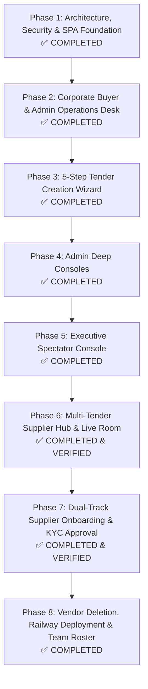

# NexTrade Auctions — Master React Migration & Modular Architecture Plan

## 1. Project Overview & Vision
NexTrade Auctions is an enterprise-grade, low-latency B2B reverse e-auction platform purpose-built for bulk industrial procurement (chemicals, petrochemicals, packaging, heavy commodities). It connects Corporate Buyers (e.g., Epack Petrochem) with vetted suppliers who compete in real-time down to the lowest bid under strict anti-sniping and decrement rules.

This project executes a **complete ground-up architectural modernization** from a fragmented prototype into a clean, unified **React Multi-SPA application powered by Vite, Tailwind CSS, TypeScript, and Express WebSockets**.

---

## 2. Platform Architecture & Realm Isolation

```
                   ┌───────────────────────────────────────┐
                   │          NexTrade Reverse Engine      │
                   └──────────────────┬────────────────────┘
                                      │
         ┌────────────────────────────┼────────────────────────────┐
         │                            │                            │
         ▼                            ▼                            ▼
┌──────────────────┐         ┌──────────────────┐         ┌──────────────────┐
│     REALM 1      │         │     REALM 2      │         │     REALM 3      │
│ Admin Operations │         │ Corporate Buyer  │         │ Supplier Network │
│  (/admin/*)      │         │  (/customer/*)   │         │  (/vendor/* &    │
│                  │         │                  │         │   /live-auction) │
├──────────────────┤         ├──────────────────┤         ├──────────────────┤
│ • Auctions Desk  │         │ • KPI Dashboard  │         │ • Multi-Tender   │
│ • Client Manager │         │ • 5-Step Intake  │         │   Supplier Hub   │
│ • Vendor Manager │         │ • Amendments     │         │ • Live Bidding   │
│ • Auction Builder│         │ • Plants Directory│        │ • Seat Lock Mutex│
│ • Audit Reports  │         │ • Approved Pool  │         │ • Unmanned Alert │
└──────────────────┘         └──────────────────┘         └──────────────────┘
```

---

## 3. Migration Roadmap & Execution Status



---

### Phase 1: Architecture, Security Firewall & React SPA Foundation
**Status:** `COMPLETED`

* [x] **Backend Schemas & Migrations**: Defined and stabilized SQLite relational models (`organizations`, `organization_facilities`, `vendors`, `company_vendors`, `tender_requests`, `tender_amendments`, `auctions`, `lots`, `bids`, `auction_invites`, `notifications`).
* [x] **Dual Build Pipeline**: Configured Vite (`vite.config.ts`) and TypeScript (`tsconfig.json`) for multi-page output (`admin.html` and `customer.html`) directly into `dist/client`.
* [x] **Anti-Cache Security Middleware**: Injected cache prevention headers across all protected realm routes.
* [x] **Universal Modal System**: Created reusable [`ConfirmModal.tsx`](file:///e:/Projects/BiddingSite/client/src/components/ConfirmModal.tsx) replacing all native browser popups.
* [x] **Reactive Deep Linking**: Built [`useNotifications.ts`](file:///e:/Projects/BiddingSite/client/src/hooks/useNotifications.ts) and [`NotificationBell.tsx`](file:///e:/Projects/BiddingSite/client/src/components/NotificationBell.tsx) connected to React Router navigation.

---

### Phase 2: Corporate Buyer Dashboard & Admin Operations Desk Baseline
**Status:** `COMPLETED & VERIFIED`

* [x] **Corporate Buyer Command Center ([`CustomerDashboard.tsx`](file:///e:/Projects/BiddingSite/client/src/customer/pages/CustomerDashboard.tsx))**:
  - Direct financial KPI tracking: Committed Spend, Total Savings, Active Auctions, Settled Contracts.
  - Pending Review Queue: Dual action buttons on intake requests (**"✏️ Edit Specs"** & **"🔍 Inspect / Sign Off"**).
  - Inspection & Sign-Off Modal ([`InspectRequestModal.tsx`](file:///e:/Projects/BiddingSite/client/src/customer/pages/InspectRequestModal.tsx)) with clean URL stripping (`?inspectRequest=`).
  - Spec Edit Modal ([`CustomerEditRequestModal.tsx`](file:///e:/Projects/BiddingSite/client/src/customer/pages/CustomerEditRequestModal.tsx)) with dynamic multi-lot editor.
  - Governed Amendment Submission ([`CustomerAmendmentModal.tsx`](file:///e:/Projects/BiddingSite/client/src/customer/pages/CustomerAmendmentModal.tsx)) for scheduled auctions.
  - Delivery Plants Directory with Add/Delete facility modal ([`AddFacilityModal.tsx`](file:///e:/Projects/BiddingSite/client/src/customer/pages/AddFacilityModal.tsx)).
  - Authorized Supplier Pool with Add/Delete vendor modal ([`AddSupplierModal.tsx`](file:///e:/Projects/BiddingSite/client/src/customer/pages/AddSupplierModal.tsx)).
  - Amendments History tracking desk review notes and status badges.
* [x] **Admin Operations Desk ([`AuctionsManager.tsx`](file:///e:/Projects/BiddingSite/client/src/admin/pages/AuctionsManager.tsx))**:
  - Live tender intake review queue with lot reserve price editor ([`ReviewRequestModal.tsx`](file:///e:/Projects/BiddingSite/client/src/admin/pages/ReviewRequestModal.tsx)).
  - Pending amendment decisions queue with 1-click Approve & Apply to database.
  - Tokenized Magic Link viewer & generator ([`InvitesModal.tsx`](file:///e:/Projects/BiddingSite/client/src/admin/pages/InvitesModal.tsx)).
  - Official Settlement Audit PDF generation and spectator room launchers.
* [x] **Universal Search Component ([`SearchBar.tsx`](file:///e:/Projects/BiddingSite/client/src/components/SearchBar.tsx))**:
  - Real-time search with instant clear button (`✕`) across Auctions, Facilities, Suppliers, Amendments, and Admin Desk.
* [x] **De-cluttering**: Safely purged legacy monolithic files (`dashboard.html`, `dashboard.js`, `auctions.html`, `auctions.js`).

---

### Phase 3: 5-Step Tender Creation Wizard
**Status:** `COMPLETED & VERIFIED`

* [x] **End-to-End Guided Wizard ([`TenderCreationWizard.tsx`](file:///e:/Projects/BiddingSite/client/src/customer/pages/TenderCreationWizard.tsx))**:
  - Step 1: Corporate Category & Sourcing Profile.
  - Step 2: Multi-Lot Specifications Grid (dynamic add/remove, quantity, UOM, reserve price, bid decrement).
  - Step 3: Scheduling & Anti-Sniping Controls.
  - Step 4: Facility Delivery Terms & Compliance Checklist.
  - Step 5: Supplier Selection & Custom Vendor Invitations.
* [x] **Interactive Review & Instant Submit**: Generates real-time intake request (`REQ-EPACK-YYYY-XX`) routed to Admin Operations Desk.

---

### Phase 4: Admin Deep Consoles
**Status:** `COMPLETED & VERIFIED`

* [x] **Enterprise Clients Management Console ([`ClientsManager.tsx`](file:///e:/Projects/BiddingSite/client/src/admin/pages/ClientsManager.tsx))**:
  - Live corporate client directory with GSTIN/PAN verification.
  - Modal workflows to register new corporate buyers and manage facilities.
* [x] **Master Vendors Management Console ([`VendorsManager.tsx`](file:///e:/Projects/BiddingSite/client/src/admin/pages/VendorsManager.tsx))**:
  - Vetted supplier catalog with approval status lifecycle (`approved`, `pending`, `blacklisted`).
  - Add/Edit vendor modals with universal search.
* [x] **Standalone Auction Builder Console ([`AuctionBuilder.tsx`](file:///e:/Projects/BiddingSite/client/src/admin/pages/AuctionBuilder.tsx))**:
  - Direct auction creation bypassing intake requests.
  - Auto-seeds lots, invites vendors, and publishes live/scheduled auctions.

---

### Phase 5: Executive Read-Only Spectator / Observer Console
**Status:** `COMPLETED & VERIFIED`

* [x] **Executive Spectator Room ([`ObserverApp.tsx`](file:///e:/Projects/BiddingSite/client/src/observer/ObserverApp.tsx))**:
  - Live, low-latency WebSocket feed of incoming price drops.
  - Procurement savings margin meter (Start Price vs Current L1 vs Total Savings).
  - Chronological bidding audit trail with bidder attribution.
  - Audio chimes using Web Audio API on bid events.
  - Dual access: authenticated corporate buyers + tokenized observer links.

---

### Phase 6: Multi-Tender Supplier Hub, Single-Bidder Seat Lock & Live Room
**Status:** `COMPLETED & VERIFIED`

* [x] **2-Tier Supplier Authentication**:
  - **Tier 1 (Instant Gateway)**: Opening any invited tender link auto-issues signed `nta_vendor_session` cookie (zero email burned).
  - **Tier 2 (Direct Login)**: Dedicated supplier portal login (`/vendor/login` / [`VendorLogin.tsx`](file:///e:/Projects/BiddingSite/client/src/vendor/VendorLogin.tsx)) using Email + Permanent PIN/Password (no public GSTIN risk, zero OTP quota exhaustion).
* [x] **Multi-Tender Supplier Hub ([`VendorDashboardApp.tsx`](file:///e:/Projects/BiddingSite/client/src/vendor/VendorDashboardApp.tsx))**:
  - Unified view of all assigned tenders across corporate buyers.
  - Categorized into Live (with manned/unmanned tags), Upcoming, and Concluded tenders.
  - Universal real-time search across tender portfolio.
* [x] **Single-Bidder Seat Concurrency Lock**:
  - First company member to join claims the active bidding seat.
  - Colleague terminals join in **Read-Only Mirror Mode** to prevent accidental conflicting bids.
  - **60-Second Grace Timer**: Protects the primary seat from being hijacked during quick page refreshes or Wi-Fi drops.
  - Voluntary seat relinquishment and claiming controls.
* [x] **Smart Presence-Aware Routing (Unattended Tender Alert)**:
  - If an outbid occurs in Auction A and an employee is inside Auction A, the alert stays strictly in Room A.
  - If Auction A is **unmanned** by the company, an urgent broadcast is dispatched across the company's other active rooms and Supplier Hub: *"🚨 Unattended Tender Alert: You were outbid in Auction A and no active bidder is in the room!"*
* [x] **Confidential Supplier Outcome Certificate ([`vendor-report-generator.ts`](file:///e:/Projects/BiddingSite/src/vendor-report-generator.ts))**:
  - Tailored PDF certificate displaying only the vendor's own bids, final winning price, and legal participation seal.
  - **Antitrust & Price-Blind**: Strictly redacts competitor identities, competitor price histories, and client reserve prices.
* [x] **Live Reverse Bidding Terminal ([`VendorBiddingApp.tsx`](file:///e:/Projects/BiddingSite/client/src/vendor/VendorBiddingApp.tsx))**:
  - Pre-Auction Waiting Room with synchronized countdown.
  - Clamped stepper inputs, 1-Click `⚡ Quick Bid`, and self-outbid caution modals.
  - Dynamic Anti-Sniping soft-close clock extensions.
  - Direct navigation button to `🏢 Supplier Hub`.

---

### Phase 7: Dual-Track Supplier Onboarding & KYC Approval Architecture
**Status:** `COMPLETED & VERIFIED`

* [x] **Dual-Track Workflow Engine**:
  - **Track A (Email-Only / Partial Invitation)**: Generates `/vendor/onboard?token=...` allowing supplier to fill legal business name, contact person, mobile, 15-char GSTIN, 10-char PAN, address, and create 6-digit PIN. Submission sets status to `pending_approval`.
  - **Track B (Pre-Filled Express Activation)**: For vendors whose master data was pre-filled by Admin/Buyer. Generates `/vendor/setup-pin?token=...` displaying read-only company details and asking only for 6-digit PIN setup. Immediate activation and auto-login to Supplier Hub.
* [x] **Enterprise Gateway Routing & Firewall**:
  - Whitelisted `/vendor/onboard`, `/vendor/register`, `/vendor/setup-pin` through `requireVendorAuth` and Express router.
  - Mounted `<VendorOnboarding />` in [`client/src/vendor/main.tsx`](file:///e:/Projects/BiddingSite/client/src/vendor/main.tsx).
* [x] **Zero Dummy Data Guarantee**:
  - Removed all hardcoded mock accounts (`goldglobalfuels@gmail.com | PIN: 123456`) and fake names.
  - Enforced real database validation: unregistered and pending suppliers are blocked at `/api/vendor/login` with clear compliance messages.
* [x] **Admin KYC & Vendor Management Integration ([`VendorsManager.tsx`](file:///e:/Projects/BiddingSite/client/src/admin/pages/VendorsManager.tsx))**:
  - Added `+ Invite / Onboard Supplier` modal with instant link generator and 1-click clipboard copy.
  - Added per-row `🔗 Link` copy button to retrieve active onboarding/setup links anytime.
  - Seamless 1-click `✓ Approve KYC` button for pending applications.

---

### Phase 8: Vendor Deletion Engine, Railway Deployment & Team Roster
**Status:** `COMPLETED & VERIFIED`

* [x] **Audit-Safe Vendor Deletion & Force Wipe**:
  - Zero-bid vendors deleted cleanly with 1-click confirmation.
  - Vendors with historical bids protected by audit compliance warning: supports both safe deactivation (`status = 'blacklisted'`) and force-wipe of test data.
* [x] **Automated Transactional Email Engine ([`src/email-service.ts`](file:///e:/Projects/BiddingSite/src/email-service.ts))**:
  - Integrated Resend REST API for production emails (Supplier Invitations, PIN Setup, KYC Approvals, Tender Reminders).
  - Built-in offline development logger for seamless local testing.
* [x] **Production Railway Configuration**:
  - Added [`Dockerfile`](file:///e:/Projects/BiddingSite/Dockerfile), [`railway.json`](file:///e:/Projects/BiddingSite/railway.json), and [`.dockerignore`](file:///e:/Projects/BiddingSite/.dockerignore) for 1-click containerized cloud deployment with persistent volume support for SQLite.
* [x] **Multi-Employee Team Rosters**:
  - Support for multi-user Corporate Buyer organizations (`platform_users.organization_id`) with role-based job titles.
  - Support for Supplier Company sub-teams (`vendor_team_members`), integrated with the live room Single-Bidder Seat Lock.

---

## 4. Engineering Rules & Protocol

1. **Strict User Execution Rule**: The AI assistant must **never execute shell/terminal commands directly**; exact copy-pasteable commands must be provided for the user to run in their PowerShell terminal.
2. **Zero Native Alerts**: Never introduce `window.alert()` or `window.confirm()`. Always use branded in-app modals.
3. **Verification Before Deletion**: Never delete a legacy file until its React replacement is fully built, compiled via Vite, and tested on the running server.
4. **Git Hygiene**: Always run `git status` and maintain committed milestones before opening a new phase.
