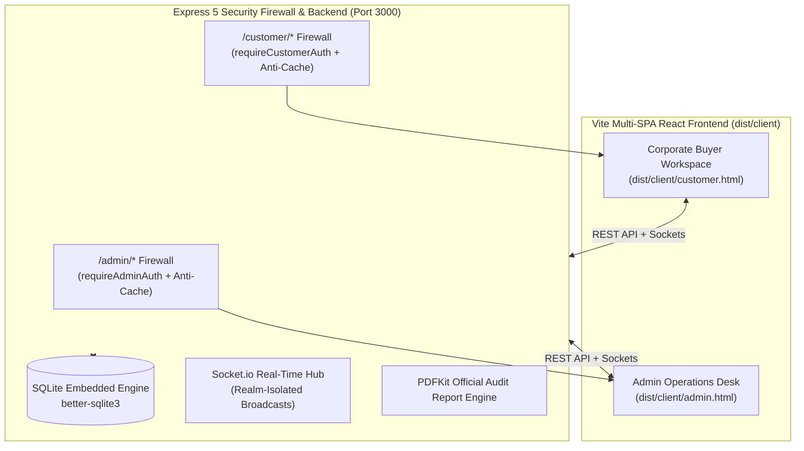
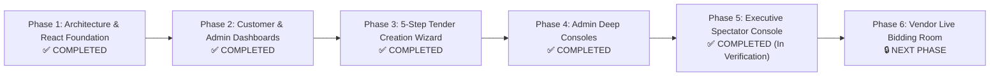

# NexTrade Auctions (NTA) — Master Architecture & Execution Plan

**System:** Industrial B2B Reverse E-Auction & Procurement Platform  
**Target Benchmark:** SAP Ariba / Coupa / PrimeTrade Auctions  
**Document Status:** Living Master Roadmap (Updated: October 31, 2026)  
**Primary Workspaces:** `e:\Projects\BiddingSite`

---

## 1. Executive Summary & Evolutionary Context

NexTrade Auctions is an enterprise-grade, low-latency B2B reverse auction platform designed for industrial procurement. Corporate buyers (e.g. *Epack Petrochem Solutions*) host scheduled reverse auctions for bulk commodities, raw materials, and packaging, allowing pre-vetted vendors to compete in real-time down to the lowest bid (L1).

### The Technology Pivot:
* **Initial Prototype (Deprecated)**: Began as monolithic Vanilla JavaScript (`dashboard.js`, `auctions.js`) and static HTML (`dashboard.html`, `auctions.html`). This caused severe DOM layering issues, untracked state, stuck browser URL query parameters, and jarring browser alerts (`localhost:3000 says`).
* **Current Production Standard (Active)**: Migrated to a **Server-Guarded Multi-SPA in React 19 + TypeScript + Vite 8** backed by an **Express 5 + SQLite (`better-sqlite3`) + Socket.io** backend.
* **Core Principle**: Complete and polish the **Admin Operations Desk** and **Corporate Buyer Workspace** (Phases 1–5) before initiating the **Vendor Bidding Engine** (Phase 6).

---

## 2. System Architecture & Security Baseline



### Architectural Tenets:
1. **Server-Guarded Multi-SPA**: React client bundles for Admin and Customer are compiled separately into `dist/client/` and served behind strict Express session middleware (`requireAdminAuth` and `requireCustomerAuth`). Unauthenticated users cannot inspect internal bundles.
2. **Anti-Cache Protection**: HTTP headers (`no-store, no-cache, must-revalidate, max-age=0`) force fresh auth validation on browser Back/Forward navigation.
3. **Zero Native Alerts**: All blocking `window.confirm()` and `alert()` calls are eliminated in favor of branded in-app enterprise modals (`ConfirmModal.tsx`).
4. **Reactive URL State Synchronization**: Modals and drawers synchronize seamlessly with React Router (`useSearchParams`). Closing a modal cleans the URL address bar immediately with zero full-page reload.
5. **Concluded Auction Immutability & Bid Integrity Gate**: Concluded auctions (`ended`) are write-locked in perpetuity. The bid engine strictly validates that the parent auction is in active `live`/`extended` status and that `currentTime < current_end` before accepting any bid. Historical auctions can never be revived or accept late bids.

---

## 3. Master Phased Execution Roadmap



---

### Phase 1: Architecture, Security Firewall & React SPA Foundation
**Status:** `COMPLETED`

* [x] **Backend Schemas & Migrations**: Defined and stabilized SQLite relational models (`organizations`, `organization_facilities`, `vendors`, `company_vendors`, `tender_requests`, `tender_amendments`, `auctions`, `lots`, `bids`, `auction_invites`, `notifications`).
* [x] **Dual Build Pipeline**: Configured Vite (`vite.config.ts`) and TypeScript (`tsconfig.json`) for multi-page output (`admin.html` and `customer.html`) directly into `dist/client`.
* [x] **Anti-Cache Security Middleware**: Injected cache prevention headers across all protected realm routes.
* [x] **Universal Modal System**: Created reusable [`ConfirmModal.tsx`](file:///e:/Projects/BiddingSite/client/src/components/ConfirmModal.tsx) replacing all native browser popups.
* [x] **Reactive Deep Linking**: Built [`useNotifications.ts`](file:///e:/Projects/BiddingSite/client/src/hooks/useNotifications.ts) and [`NotificationBell.tsx`](file:///e:/Projects/BiddingSite/client/src/components/NotificationBell.tsx) connected to React Router navigation.

---

### Phase 2: Corporate Buyer Dashboard & Admin Operations Desk Baseline
**Status:** `COMPLETED & VERIFIED`

* [x] **Corporate Buyer Command Center ([`CustomerDashboard.tsx`](file:///e:/Projects/BiddingSite/client/src/customer/pages/CustomerDashboard.tsx))**:
  - Direct financial KPI tracking: Committed Spend, Total Savings, Active Auctions, Settled Contracts.
  - Pending Review Queue: Dual action buttons on intake requests (**"✏️ Edit Specs"** & **"🔍 Inspect / Sign Off"**).
  - Inspection & Sign-Off Modal ([`InspectRequestModal.tsx`](file:///e:/Projects/BiddingSite/client/src/customer/pages/InspectRequestModal.tsx)) with clean URL stripping (`?inspectRequest=`).
  - Spec Edit Modal ([`CustomerEditRequestModal.tsx`](file:///e:/Projects/BiddingSite/client/src/customer/pages/CustomerEditRequestModal.tsx)) with dynamic multi-lot editor.
  - Governed Amendment Submission ([`CustomerAmendmentModal.tsx`](file:///e:/Projects/BiddingSite/client/src/customer/pages/CustomerAmendmentModal.tsx)) for scheduled auctions.
  - Delivery Plants Directory with Add/Delete facility modal ([`AddFacilityModal.tsx`](file:///e:/Projects/BiddingSite/client/src/customer/pages/AddFacilityModal.tsx)).
  - Authorized Supplier Pool with Add/Delete vendor modal ([`AddSupplierModal.tsx`](file:///e:/Projects/BiddingSite/client/src/customer/pages/AddSupplierModal.tsx)).
  - Amendments History tracking desk review notes and status badges.
* [x] **Admin Operations Desk ([`AuctionsManager.tsx`](file:///e:/Projects/BiddingSite/client/src/admin/pages/AuctionsManager.tsx))**:
  - Live tender intake review queue with lot reserve price editor ([`ReviewRequestModal.tsx`](file:///e:/Projects/BiddingSite/client/src/admin/pages/ReviewRequestModal.tsx)).
  - Pending amendment decisions queue with 1-click Approve & Apply to database.
  - Tokenized Magic Link viewer & generator ([`InvitesModal.tsx`](file:///e:/Projects/BiddingSite/client/src/admin/pages/InvitesModal.tsx)).
  - Official Settlement Audit PDF generation and spectator room launchers.
* [x] **Universal Search Component ([`SearchBar.tsx`](file:///e:/Projects/BiddingSite/client/src/components/SearchBar.tsx))**:
  - Real-time search with instant clear button (`✕`) across Auctions, Facilities, Suppliers, Amendments, and Admin Desk.
* [x] **De-cluttering**: Safely purged legacy monolithic files (`dashboard.html`, `dashboard.js`, `auctions.html`, `auctions.js`).

---

### Phase 3: The 5-Step Guided Tender Creation Wizard (`/customer/request-tender`)
**Status:** `COMPLETED & VERIFIED`

Migrated the legacy wizard (`request-tender.html` / `request-tender.js`) into a modern, sequential React component ([`TenderCreationWizard.tsx`](file:///e:/Projects/BiddingSite/client/src/customer/pages/TenderCreationWizard.tsx)):

```
[ Step 1: Scope & Plant ] ➔ [ Step 2: Lot Economics ] ➔ [ Step 3: Supplier Pool ] ➔ [ Step 4: Terms & Delivery ] ➔ [ Step 5: Review & Submit ]
```

* [x] **Step 1: Event Scope & Plant Selection**:
  - Pre-populate authenticated company profile (*Epack Petrochem Solutions*, GSTIN, Contact Person, Email, Phone).
  - Tender Title, Procurement Category, Duration (15–240 mins), Target Date/Time.
  - Delivery Plant picker pulling live facilities from SQLite with inline "+ Specify Custom Delivery Location" option.
* [x] **Step 2: Lot Specifications & Economics**:
  - Dynamic spreadsheet-style lot grid (Product Name, Category, Quantity, UOM, Reserve Ceiling, Decrement).
  - Real-time combined budget ceiling counter ($\sum \text{Qty} \times \text{Reserve Price}$).
  - Bulk CSV template download (`NexTrade_Tender_Lots_Template.csv`) & CSV file upload parser.
* [x] **Step 3: Supplier Pool Allocation**:
  - Pre-approved company vendor pool checklist with 1-click **"Select All"** toggle.
  - External supplier invitation rows (Company Name, Contact Person, Phone, Email).
* [x] **Step 4: Commercial Terms & Compliance**:
  - Commercial terms dropdown (*30 Days Net*, *Immediate on Inspection*, *45 Days PDC*).
  - Delivery timeline, logistics requirements, and quality certification checkboxes.
* [x] **Step 5: Executive Review & Submission**:
  - Read-only executive summary card summarizing all parameters, lot items, total reserve budget, and invited suppliers.
  - Submit action calling `POST /api/customer/tender-requests`.
  - Pop-up confirmation with generated tracking ID (e.g. `REQ-EPACK-2026-02`) and desk notification push.
* [x] **Testing & Cleanup**: Vite compiled cleanly (128ms); retired legacy `private/customer/request-tender.html` and `public/js/customer/request-tender.js`.

---

### Phase 4: Admin Enterprise Consoles (Client Management, Vendor KYC, & Builder)
**Status:** `COMPLETED & VERIFIED`

Port remaining administrative tools into modular React views under the Admin layout:

* [x] **Corporate Clients Manager (`/admin/clients`)**:
  - Ported `private/admin/clients.html` and `public/js/admin/clients.js` to React ([`ClientsManager.tsx`](file:///e:/Projects/BiddingSite/client/src/admin/pages/ClientsManager.tsx)).
  - View corporate buyer organizations, search and filter by name/GSTIN/code via [`SearchBar.tsx`](file:///e:/Projects/BiddingSite/client/src/components/SearchBar.tsx), register new corporate clients, and manage exclusive corporate vendor pools with modal link/register/unlink controls.
* [x] **Vendor KYC & Verification Console (`/admin/vendors`)**:
  - Ported `private/admin/vendors.html` and `public/js/admin/vendors.js` to React ([`VendorsManager.tsx`](file:///e:/Projects/BiddingSite/client/src/admin/pages/VendorsManager.tsx)).
  - Master supplier table with GSTIN/PAN verification status, business phone, contact person, compliance status badges, and assigned corporate buyers.
  - 1-click KYC Approve toggle calling `POST /api/admin/vendors/:id/approve` and modal to assign verified suppliers to corporate buyers.
* [x] **Advanced Auction Builder & Editor Console (`/admin/auction-editor`)**:
  - Ported `private/admin/auction-editor.html` and `public/js/admin/auction-editor.js` to React ([`AuctionBuilder.tsx`](file:///e:/Projects/BiddingSite/client/src/admin/pages/AuctionBuilder.tsx)).
  - Supports both **Create Mode** (auto-sequential ID generator, client picker, default lots) and **Edit Mode** (`?id=...`, material update notification toggle, and live/ended lock protection).
  - Multi-lot dynamic builder, delivery location, commercial instructions, anti-sniping rules, and vendor pool checklist modal.
* [x] **Routing & Layout Integration**:
  - Connected in [`AdminApp.tsx`](file:///e:/Projects/BiddingSite/client/src/admin/AdminApp.tsx) with active tab styling and React Router navigation.
  - Updated [`src/routes/public.routes.ts`](file:///e:/Projects/BiddingSite/src/routes/public.routes.ts) to serve `sendAdminBundle` on `/admin/clients`, `/admin/vendors`, and `/admin/auction-editor`.
* [x] **Visited Link Color Neutralization**: Added explicit `.btn-white:visited` rules in `<style>` across HTML headers and components, ensuring pure white text regardless of browser history.
* [x] **Cleanup**: Retired legacy `clients.html`, `vendors.html`, `auction-editor.html` and their corresponding `.js` files.

---

### Phase 5: Executive Read-Only Spectator / Observer Room
**Status:** `COMPLETED (In Verification)`

Modernize `/observer/:id` (accessible by authenticated corporate buyers, desk supervisors, and guest invite tokens):

* [x] **Port Spectator View to React ([`ObserverApp.tsx`](file:///e:/Projects/BiddingSite/client/src/observer/ObserverApp.tsx))**:
  - Standalone SPA entry point: [`client/observer.html`](file:///e:/Projects/BiddingSite/client/observer.html) & [`client/src/observer/main.tsx`](file:///e:/Projects/BiddingSite/client/src/observer/main.tsx).
  - Secure room access via customer session cookie, admin session cookie, or external spectator key (`?key=token_...`).
  - Synchronized NTP countdown timer displaying active bidding window.
  - Direct procurement savings counter vs baseline ceiling ($+\text{₹Savings}$ and $\% \text{Savings}$).
  - **Financial Procurement Metric Integrity**: Strict enforcement that unbid lots are never counted towards "Committed Spend", accurately displaying unbid lots as **Unallocated Reserve Budget**.
  - Dynamic live bid audit trail streaming chronological price drops over WebSockets with decrement drop callouts.
  - Web Audio API Alert Engine ([`useObserverAudio.ts`](file:///e:/Projects/BiddingSite/client/src/observer/useObserverAudio.ts)) with mute toggle.
  - Anti-sniping dynamic extension notification alert banner.
  - Settlement banner when ended with direct link to download the 6-page official settlement audit report PDF.
* [x] **Build & Route Pipeline**:
  - Added `observer` input bundle to `vite.config.ts`.
  - Updated Express `src/routes/public.routes.ts` to serve `sendObserverBundle` with anti-cache headers.
* [ ] **Cleanup**: Retire legacy `public/customer-observer.html` and `public/js/customer-observer.js` upon verification.

---

### Phase 6: [FINAL PHASE] Vendor Live Reverse Bidding Room & High-Concurrency Engine
**Status:** `PARKED UNTIL PHASES 1–5 ARE VERIFIED`

*All vendor-facing mechanics are consolidated here and will be executed only after the Admin and Customer portals are 100% complete:*

* [ ] **Tokenized Magic Link Authentication**:
  - Secure, passwordless vendor access via tokenized URL: `/auction/:id?key=token_...`.
  - Automatic session cookie establishment and validation against SQLite `auction_invites`.
  - Waiting Room state for vendors arriving before the scheduled start time.
* [ ] **High-Concurrency Real-Time Bidding Room**:
  - WebSocket room subscription scoped strictly to the auction event.
  - Concurrency safety: atomic bid validation (must be at or below current lowest bid minus min decrement).
  - Real-time downward price drop broadcasts to all participants.
* [ ] **Anti-Sniping Clock Extension Engine**:
  - Automatic extension trigger (e.g. extending duration by 3 minutes if a bid arrives within the final 2 minutes of the clock).
* [ ] **Supplier Bidding UI & Rank Feedback**:
  - Real-time rank indicators: **L1 (Lowest / Leading)** vs **Outbid / Behind**.
  - One-click decrement bid button and custom bid input with ceiling clamps.
* [ ] **Post-Auction Conclusion & Settlement**:
  - Event settlement computation: winning supplier selection per lot, total savings generated.
  - Automatic generation of the 6-page official settlement PDF report matching the `PTA-EPACKPetro-07` industry benchmark.

---

## 4. Engineering Rules & Protocol

1. **Strict User Execution Rule**: The AI assistant must **never execute shell/terminal commands directly**; exact copy-pasteable commands must be provided for the user to run in their PowerShell terminal.
2. **Zero Native Alerts**: Never introduce `window.alert()` or `window.confirm()`. Always use branded in-app modals.
3. **Verification Before Deletion**: Never delete a legacy file until its React replacement is fully built, compiled via Vite, and tested on the running server.
4. **Git Hygiene**: Always run `git status` and maintain committed milestones before opening a new phase.

