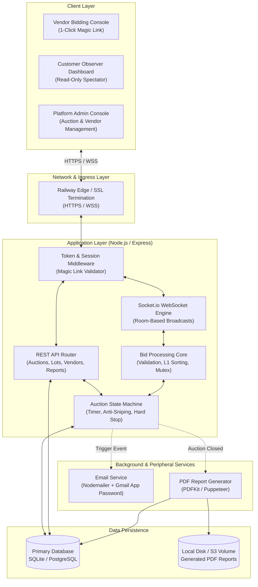

# System Architecture Specification

## 1. Executive Summary

This document specifies the architectural design for a specialized, low-latency B2B e-auction platform built for planned reverse auctions. The system handles multi-lot competitive procurement events with real-time price updates, 1-click vendor access, anti-sniping protection, and automated post-auction PDF reporting.

---

## 2. Infrastructure & Hosting Strategy (Railway)

### Why Railway?
- **Persistent Execution**: Unlike serverless or free-tier cloud functions that freeze or sleep after 15 minutes of inactivity, Railway runs continuous containers 24/7.
- **WebSocket Stability**: Live bidding requires persistent TCP/WebSocket connections (`Socket.io`). Railway provides native, uninterrupted WebSocket support without random dropped connections.
- **Predictable Cost Model**: Generous starter tier with resource-based usage billing (\$5 credit), avoiding artificial shutdown triggers (like Oracle Cloud's 20% idle CPU reclamation rule).
- **Zero Inactivity Pauses**: When auction invite links are distributed days in advance, the site is always awake and delivers an active "Scheduled Countdown & Waiting Room" screen.

---

## 3. High-Level System Architecture

---

## 4. Key Architectural Components

### 4.1. Edge & Transport Layer
- **Protocols**: HTTPS for REST APIs and page assets; WSS (Secure WebSockets) for real-time bid broadcasts and synchronized countdown ticks.
- **SSL Termination**: Managed automatically by Railway with valid certificates for custom domains.

### 4.2. Authentication & Authorization (Magic Link Model)
- **Tokenized URLs**: Each vendor receives an invite URL containing a cryptographically secure 256-bit token (`/live-auction/{auction_id}?key={secure_token}`).
- **Session Provisioning**: Upon first visit, the server validates the key against the database, sets an HTTP-only, secure session cookie on the vendor's device, and grants access.
- **Role Isolation**:
  - `admin`: Full control to create auctions, add lots, invite vendors, adjust timers, and trigger reports.
  - `customer`: Read-only observer mode. All bidding inputs (`Bid`, `Submit`) are disabled; view displays live price drops, $L_1$ vendor ranks, and calculated procurement savings.
  - `vendor`: Interactive bidding mode. Allowed to place bids strictly within calculated decrement limits on assigned lots.

### 4.3. Real-Time Bidding Engine (`Socket.io`)
- **Room Isolation**: Each auction maps to an isolated WebSocket room: `auction:{auction_id}`.
- **Independent Lot State**: Multiple products/lots exist within the same room. Bid events specify `{ lot_id, amount }`. State changes on Lot 1 never affect Lot 2.
- **Server-Authoritative Clock**: Timers are computed strictly against the server's NTP-synchronized clock. Client local clocks are ignored, preventing tampering or device-clock drift.

### 4.4. Concurrency & Race-Condition Guard
- **The Challenge**: If Vendor A and Vendor B hit `Submit` at the exact same millisecond with conflicting amounts, only the first received valid bid may set the new $L_1$.
- **The Solution**: An in-memory queue/mutex locks the specific `lot_id` for $< 5$ milliseconds while validating the bid against the latest lowest amount. Once committed, the lock releases and broadcasts the new state.

### 4.5. Mail Worker (Nodemailer + Gmail App Password)
- Configured for small-scale, high-reliability delivery (20–30 emails per event).
- Implements staggered sending (100ms delay between emails) to adhere to Gmail SMTP rate limits.
- Provides fallback links directly on the Admin Dashboard with 1-click WhatsApp copy-to-clipboard buttons.

### 4.6. Automated PDF Generation Worker
- Triggered immediately when an auction reaches `status: 'ended'`.
- Uses a templated layout engine (PDFKit or headless Chrome via Puppeteer) to produce the standard 6-page compliance and settlement report.
- Saves the binary to disk/volume storage and updates the database record with the file path.

