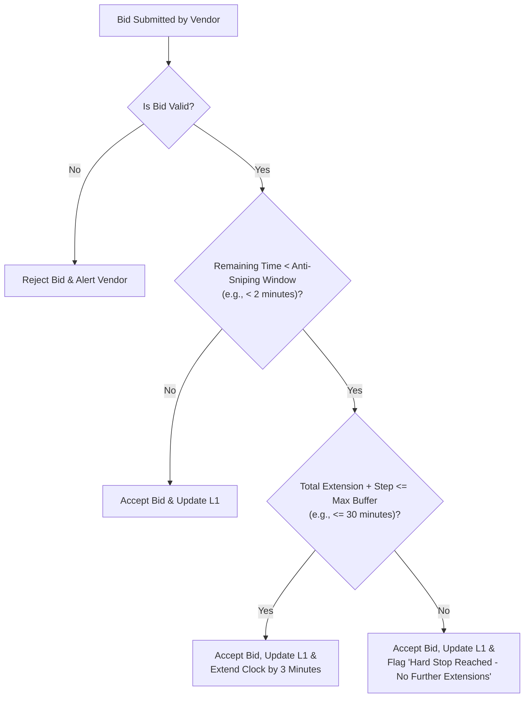

# Auction Rules, Logic & Mathematical Models

## 1. Core Reverse Auction Mechanics

In this platform, all bidding events operate on a **Reverse Auction** model:
- The corporate buyer (e.g., Epack) seeks to procure items or services at the lowest possible price.
- The `start_price` represents the starting ceiling price per unit.
- Vendors compete by offering successively lower bids.
- The lowest bidder at the time of auction closure ($L_1$) is awarded the contract, provided the bid meets or beats the `reserve_price`.

---

## 2. Bid Validation & Decrement Calculations

### 2.1. Maximum Allowed Bid Rule
At any moment during a live auction, the UI and the backend enforce a strict maximum ceiling on the next incoming bid for a given lot:

$$\text{Max Allowed Bid} = 
\begin{cases} 
\text{start\_price}, & \text{if } \text{current\_lowest\_bid is NULL} \\
\text{current\_lowest\_bid} - \text{bid\_decrement}, & \text{otherwise}
\end{cases}$$

### 2.2. Validation Rules
A submitted bid amount $B$ for a lot is valid if and only if:
1. $B > 0$
2. $B \le \text{Max Allowed Bid}$
3. $( \text{Max Allowed Bid} - B ) \pmod{\text{bid\_decrement}} = 0$ *(optional, prevents arbitrary odd paisa increments)*
4. The submitting vendor is approved and verified.
5. The lot status is `open` or `extended` (not `closed`).

### 2.3. Example from PTA-EPACKPetro-07
- **Lot 1: Pallets Epackpetro-07**
  - Quantity: 5,000 Nos
  - Decrement: ₹5
  - Current Lowest Bid: ₹1,340
  - Next Max Allowed Bid: ₹1,340 - ₹5 = **₹1,335**
  - Vendor can submit ₹1,335, ₹1,330, ₹1,325, etc.

---

## 3. Dynamic Anti-Sniping & The Absolute Hard Stop

To prevent bots or aggressive bidders from submitting bids at `00:00:01` without allowing competitors time to react, the engine utilizes a **Dynamic Soft Close with an Absolute Buffer**.

### 3.1. Parameters
- $T_{\text{scheduled\_end}}$: Original planned closing timestamp.
- $\Delta t_{\text{trigger}}$: Threshold window before closure that triggers extension (default: 2 minutes).
- $\Delta t_{\text{step}}$: Extension time added when triggered (default: 3 minutes).
- $\Delta t_{\text{max\_buffer}}$: Maximum allowable cumulative extension (default: 15–30 minutes).

### 3.2. Absolute Hard Stop Ceiling
The absolute wall-clock deadline beyond which **no further extensions are permitted under any condition**:

$$T_{\text{hard\_stop}} = T_{\text{scheduled\_end}} + \Delta t_{\text{max\_buffer}}$$

If a valid bid arrives when $T_{\text{remaining}} < \Delta t_{\text{trigger}}$:
- If $(T_{\text{current\_end}} + \Delta t_{\text{step}}) \le T_{\text{hard\_stop}}$, set $T_{\text{current\_end}} = T_{\text{current\_end}} + \Delta t_{\text{step}}$.
- Otherwise, set $T_{\text{current\_end}} = T_{\text{hard\_stop}}$ and emit a WebSocket `hard_stop_reached` event.

---

## 4. Multi-Lot Independent State Management

When multiple products are auctioned in the same room (e.g., Pallets and Coal):
1. **Isolated Bidding State**:
   - Each lot has an independent `current_lowest_bid`, `current_l1_vendor_id`, and bid history log.
   - Placing a bid on Lot 1 never modifies or locks Lot 2.
2. **Independent Timers (Per-Lot Closure)**:
   - If Lot 1 experiences active bidding wars and triggers anti-sniping extensions, Lot 1 extends.
   - If Lot 2 has had no bids for the last 15 minutes, Lot 2 concludes at its scheduled closing time and freezes into `closed` status.
   - This prevents active bidders on finished items from waiting unnecessarily.

---

## 5. L1, L2, L3 Ranking & Default Fallback Logic

In industrial procurement, auction winners frequently face operational contingencies (capacity shortages, failure to post performance guarantees, or backing out).

### 5.1. Hierarchy
- **$L_1$ (Lowest 1 - Primary Awardee)**: The vendor with the lowest price at closure. First right of refusal for 100% of the volume.
- **$L_2$ (Lowest 2 - Standby / Backup Awardee)**: The vendor with the second lowest price.
- **$L_3$ (Lowest 3)**: Third lowest price.

### 5.2. Default & Forfeiture Protocol
1. $L_1$ is given a contractual acceptance window (e.g., 24–48 hours) to sign the purchase agreement.
2. If $L_1$ defaults:
   - $L_1$'s Earnest Money Deposit (EMD) or security balance is immediately **forfeited**.
   - The contract is formally offered to **$L_2$**.
   - Under standard Indian procurement rules, $L_2$ may either be offered the order at their own bid price or offered the option to match $L_1$'s price.

---

## 6. Procurement Savings Calculation

The automated report computes the direct financial value generated by the auction event for the corporate buyer.

### 6.1. Per-Lot Savings Formula
$$\text{Savings}_{\text{lot}} = (\text{Reserve Price} - \text{Winning Bid } L_1) \times \text{Quantity}$$

*(Note: If no Reserve Price was specified, $\text{Start Price}$ is substituted).*

### 6.2. Example Verification (From PTA-EPACKPetro-07)
| Lot | Quantity | Reserve Price | Winning Bid ($L_1$) | Unit Savings | Total Lot Savings |
| :--- | :--- | :--- | :--- | :--- | :--- |
| **Imported Coal** | 500 MT | ₹13,500 | ₹10,720 | ₹2,780 / MT | **₹13,90,000** |
| **Pallets** | 5,000 Nos | ₹1,500 | ₹1,135 | ₹365 / Nos | **₹18,25,000** |
| **Total Event Savings**| | | | | **₹32,15,000 (₹32.15 Lakhs)** |

Displaying this prominent savings callout on the customer dashboard and PDF executive summary demonstrates immediate ROI.

