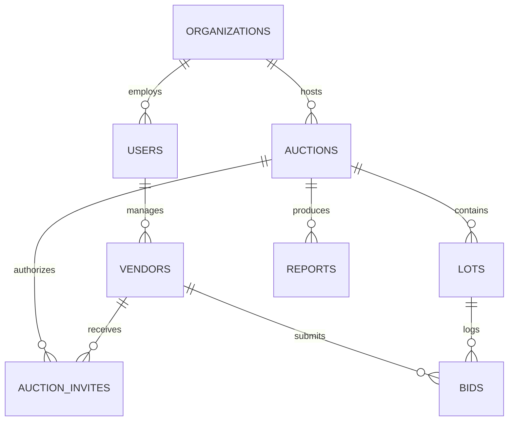

# Database Schema Specification

## 1. Overview

The database design uses a relational schema compatible with both **SQLite** (for local development and zero-overhead deployments) and **PostgreSQL** (for multi-tenant cloud scaling on Railway or Supabase).

---

## 2. Entity Relationship Diagram



---

## 3. Table Definitions & DDL

### 3.1. `organizations`
Stores client companies hosting auctions (e.g., *Epack Petrochem Solutions Pvt Ltd*) as well as the platform owner.

```sql
CREATE TABLE organizations (
    id TEXT PRIMARY KEY,                       -- e.g. 'org_epack_01'
    name TEXT NOT NULL,                        -- 'Epack Petrochem Solutions Pvt Ltd'
    gstin TEXT UNIQUE,                         -- '03AAPCP3056IZE'
    email TEXT NOT NULL,
    phone TEXT,
    address TEXT,
    created_at DATETIME DEFAULT CURRENT_TIMESTAMP
);
```

---

### 3.2. `users`
System accounts for Admins and Customer Procurement Managers.

```sql
CREATE TABLE users (
    id TEXT PRIMARY KEY,                       -- e.g. 'usr_admin_01'
    organization_id TEXT REFERENCES organizations(id),
    name TEXT NOT NULL,
    email TEXT UNIQUE NOT NULL,
    password_hash TEXT,                        -- NULL for magic-link-only users
    role TEXT CHECK(role IN ('super_admin', 'customer_admin', 'customer_observer')) NOT NULL,
    created_at DATETIME DEFAULT CURRENT_TIMESTAMP
);
```

---

### 3.3. `vendors`
Profiles of external suppliers and bidding contractors.

```sql
CREATE TABLE vendors (
    id TEXT PRIMARY KEY,                       -- e.g. 'vnd_goldglobal_01'
    company_name TEXT NOT NULL,                -- 'Gold Global Fuels'
    contact_person TEXT NOT NULL,
    email TEXT UNIQUE NOT NULL,                -- 'goldglobalfuels@gmail.com'
    phone TEXT NOT NULL,
    gstin TEXT,                                -- Validated Indian GSTIN
    pan TEXT,                                  -- Validated Indian PAN
    status TEXT CHECK(status IN ('unregistered', 'pending_approval', 'approved', 'blacklisted')) DEFAULT 'unregistered',
    approved_by TEXT REFERENCES users(id),
    approved_at DATETIME,
    created_at DATETIME DEFAULT CURRENT_TIMESTAMP
);
```

---

### 3.4. `auctions`
Parent auction events.

```sql
CREATE TABLE auctions (
    id TEXT PRIMARY KEY,                       -- Custom formatted ID: 'PTA-EPACKPetro-07'
    title TEXT NOT NULL,                       -- 'Petrochem Disposal & Procurement Event #07'
    customer_org_id TEXT REFERENCES organizations(id) NOT NULL,
    scheduled_start DATETIME NOT NULL,
    scheduled_end DATETIME NOT NULL,
    duration_minutes INTEGER NOT NULL DEFAULT 60,
    anti_sniping_minutes INTEGER NOT NULL DEFAULT 2,  -- Extends by X mins if bid in last Y mins
    extension_step_minutes INTEGER NOT NULL DEFAULT 3, -- Duration of each extension
    max_buffer_minutes INTEGER NOT NULL DEFAULT 30,    -- Hard stop ceiling
    actual_end DATETIME,
    status TEXT CHECK(status IN ('draft', 'scheduled', 'live', 'extended', 'ended', 'cancelled')) DEFAULT 'scheduled',
    created_at DATETIME DEFAULT CURRENT_TIMESTAMP
);
```

---

### 3.5. `lots`
Individual products/items within an auction running in parallel.

```sql
CREATE TABLE lots (
    id TEXT PRIMARY KEY,                       -- e.g. 'lot_epack07_coal'
    auction_id TEXT REFERENCES auctions(id) ON DELETE CASCADE NOT NULL,
    lot_number INTEGER NOT NULL,               -- 1, 2, 3...
    product_name TEXT NOT NULL,                -- 'Imported Coal _Epackpetro-07'
    category TEXT,                             -- 'Non-PCB', 'Industrial Raw Material'
    quantity REAL NOT NULL,                    -- 500
    uom TEXT NOT NULL,                         -- 'MT', 'Nos', 'Kg'
    start_price REAL NOT NULL,                 -- Initial ceiling price: 13490.00
    reserve_price REAL NOT NULL,               -- Hidden/Internal Target Price: 13500.00
    bid_decrement REAL NOT NULL,               -- Minimum price drop per bid: 10.00
    current_lowest_bid REAL,                   -- Tracks current L1: 10720.00
    current_l1_vendor_id TEXT REFERENCES vendors(id),
    status TEXT CHECK(status IN ('open', 'extended', 'closed')) DEFAULT 'open',
    created_at DATETIME DEFAULT CURRENT_TIMESTAMP
);
```

---

### 3.6. `bids`
Immutable audit log of every bid submitted.

```sql
CREATE TABLE bids (
    id INTEGER PRIMARY KEY AUTOINCREMENT,
    lot_id TEXT REFERENCES lots(id) ON DELETE CASCADE NOT NULL,
    vendor_id TEXT REFERENCES vendors(id) NOT NULL,
    amount REAL NOT NULL,
    rank_at_bid INTEGER,                       -- 1 for L1, 2 for L2, etc.
    ip_address TEXT,
    user_agent TEXT,
    created_at DATETIME DEFAULT CURRENT_TIMESTAMP
);

CREATE INDEX idx_bids_lot_amount ON bids(lot_id, amount ASC);
```

---

### 3.7. `auction_invites` (Magic Links)
Secure random access tokens generated per vendor and customer observer.

```sql
CREATE TABLE auction_invites (
    id TEXT PRIMARY KEY,
    auction_id TEXT REFERENCES auctions(id) ON DELETE CASCADE NOT NULL,
    vendor_id TEXT REFERENCES vendors(id),     -- NULL if role is customer_observer
    user_id TEXT REFERENCES users(id),         -- NULL if role is vendor
    role TEXT CHECK(role IN ('vendor', 'customer_observer')) NOT NULL,
    token TEXT UNIQUE NOT NULL,                -- Cryptographic 32-character random string
    email_sent_at DATETIME,
    first_accessed_at DATETIME,
    last_accessed_at DATETIME,
    is_revoked INTEGER DEFAULT 0,
    created_at DATETIME DEFAULT CURRENT_TIMESTAMP
);

CREATE INDEX idx_invites_token ON auction_invites(token);
```

---

### 3.8. `reports`
Metadata and storage links for generated PDF settlement reports.

```sql
CREATE TABLE reports (
    id TEXT PRIMARY KEY,                       -- e.g. 'rep_PTA-EPACKPetro-07'
    auction_id TEXT REFERENCES auctions(id) UNIQUE NOT NULL,
    file_path TEXT NOT NULL,                   -- e.g. '/storage/reports/Auction-Report-PTA-EPACKPetro-07.pdf'
    total_savings REAL,                        -- Total ₹ saved compared to reserve price
    l1_count INTEGER,
    outbid_count INTEGER,
    generated_at DATETIME DEFAULT CURRENT_TIMESTAMP
);
```

